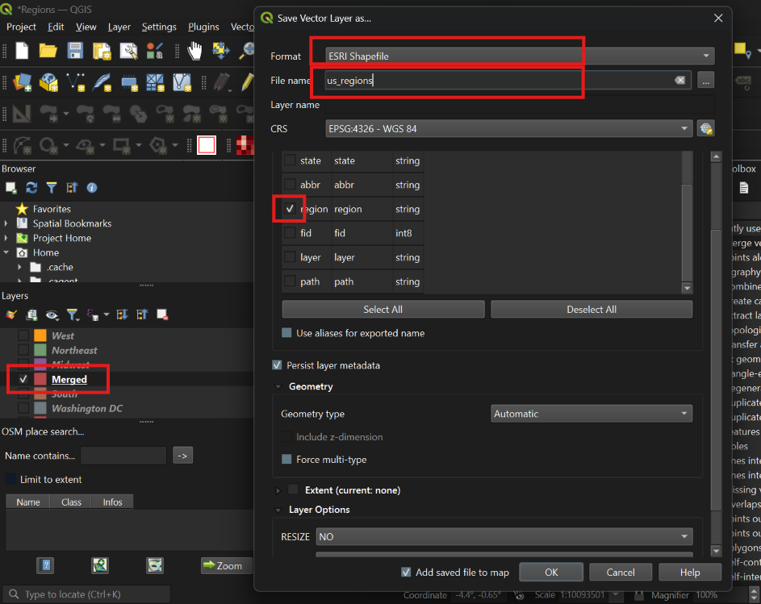

# Hex Tile Maps with Regions: From QGIS to Tableau Public

## 📝Table of Contents
1. [What Is a Hex Tile Map](#point-1)
2. [The Challenge: Regions on a Hex Map](#point-2)
3. [Creating the Hex Map Shapefile of US States](#point-3)
4. [Map with regions](#point-4)
   - 4.a) [ Way 1: Merged hexagons (no coding)](#point-4a)
   - 4.b) [ Way 2: Generate the shapefile with Python](#point-4b)
6. [Import map into Tableau](#point-5)
7. [Drill-Down effect for map](#point-6)
8. [Author and License](#point-7)

## 1. What Is a Hex Tile Map? <a id="point-1"></a>

Hex tile maps are an excellent way to display geographic data in a simplified form while preserving the relative positions of regions or states. Each state becomes an equally sized tile, so small states (like Rhode Island or Delaware) don't get lost next to huge ones (like Texas or Alaska). Alaska and Hawaii can also be placed compactly, close to the mainland, instead of sitting far away on the map.

A classic US map can be misleading: large states with minimal data visually dominate the view, while small but important ones are barely visible. Square grids solve this problem, but hexagons fit together more tightly and better reflect the actual shape of the country.

## 2. The Challenge: Regions on a Hex Map <a id="point-2"></a>

Recently, I created a [**Call Center Dashboard**](https://public.tableau.com/views/CallCenterDashboard_17482539625320/CHANNEL?:language=en-US&:sid=&:redirect=auth&:display_count=n&:origin=viz_share_link) in Tableau 
, where I needed this type of US map. The task turned out to be more interesting than simply drawing a standard map. The idea was to show different communication channels, with each channel having its own map, and each map divided into regions. Dashboard space was tight, so the map had to be very compact.

My first thought was the obvious one: build the hex map directly in Tableau, which even has dedicated functions for this. However, this approach has limitations. Here is what I got in Tableau:

 

Because every hexagon keeps its own border, there are too many lines between states that belong to the same region. This adds unnecessary visual noise.

So I decided to aim for something like this instead:

 

The hexagons are merged into regions (West, Midwest, South, Northeast and Washington DC), each with its own data. On top of that, I wanted to add a **drill-down**: clicking on a region opens a map with fewer tiles and a state-level breakdown of the data.


I needed **two maps**: one with hexagons (states) and one with regions. However, Tableau cannot merge hexagons into custom regions without internal borders. This is where my favorite tool, **QGIS**, came to the rescue, since it can produce both maps. At this point the idea felt like a real challenge. Let's go through the process step by step, using a simplified sample dataset with number of calls by states.

## 3. Creating the Hex Map Shapefile of US States in QGIS <a id="point-3"></a>

First, install QGIS. Then create a new project: in the **Project** menu, choose **New**.

 

In the bottom-right corner of the window, make sure your project uses the coordinate reference system **EPSG:4326**. 
If it doesn't, click the CRS code in the bottom-right corner, or open **Project → Properties**. In the Project Properties window, select the **CRS** tab on the left and type **EPSG:4326** into the search box.

 

> **Why EPSG:4326?** EPSG:4326 (WGS84) is the standard system of latitude and longitude coordinates, and it is exactly what Tableau expects when you import a shapefile. If your shapefile uses a different coordinate reference system (for example, one measured in meters), Tableau will place the shapes in the wrong location. This is what happened in Figure 1: the tiles ended up near point (0, 0), off the coast of Africa.

> **Not familiar with Python?** You can download a ready-made `.shp` file [here](#) (or use any other open hex-map shapefile) and start from **Step [4.a) Merging hexagons (no coding)](#point-4a) **.

Open **Plugins → Python Console → Show Editor**, paste the code, change `OUT_PATH` (the path to the folder where your files will be saved) and click **Run**.


 

Open **Plugins → Python Console → Show Editor**, paste the code and click **Run**.

```python
import math
from qgis.core import (QgsVectorLayer, QgsFeature, QgsGeometry, QgsPointXY,
                       QgsField, QgsProject)
from qgis.PyQt.QtCore import QVariant

# Settings

SIZE = 0.5       # hexagon radius in degrees
GAP = 1          # 1 = hexagons touch edge to edge, no gaps

# Tile grid layout: (abbreviation, state name, row, column)
# Rows are counted from the top (row 0). Odd rows are shifted half a hexagon to the right.
STATES = [
    ("AK","Alaska",0,0), ("ME","Maine",0,11),
    ("VT","Vermont",1,9), ("NH","New Hampshire",1,10),
    ("WA","Washington",2,1), ("MT","Montana",2,2), ("ND","North Dakota",2,3),
    ("MN","Minnesota",2,4), ("WI","Wisconsin",2,5), ("MI","Michigan",2,7),
    ("NY","New York",2,9), ("MA","Massachusetts",2,10), ("RI","Rhode Island",2,11),
    ("ID","Idaho",3,1), ("WY","Wyoming",3,2), ("SD","South Dakota",3,3),
    ("IA","Iowa",3,4), ("IL","Illinois",3,5), ("IN","Indiana",3,6),
    ("OH","Ohio",3,7), ("PA","Pennsylvania",3,8), ("NJ","New Jersey",3,9),
    ("CT","Connecticut",3,10),
    ("OR","Oregon",4,1), ("NV","Nevada",4,2), ("CO","Colorado",4,3),
    ("NE","Nebraska",4,4), ("MO","Missouri",4,5), ("KY","Kentucky",4,6),
    ("WV","West Virginia",4,7), ("MD","Maryland",4,8), ("DE","Delaware",4,9),
    ("CA","California",5,1), ("AZ","Arizona",5,2), ("UT","Utah",5,3),
    ("KS","Kansas",5,4), ("AR","Arkansas",5,5), ("TN","Tennessee",5,6),
    ("VA","Virginia",5,7), ("NC","North Carolina",5,8),
    ("DC","District of Columbia",5,11),
    ("NM","New Mexico",6,3), ("OK","Oklahoma",6,4), ("LA","Louisiana",6,5),
    ("MS","Mississippi",6,6), ("AL","Alabama",6,7), ("SC","South Carolina",6,8),
    ("TX","Texas",7,3), ("GA","Georgia",7,7),
    ("HI","Hawaii",8,0), ("FL","Florida",8,8),
]

# Geometry Helpers
W = math.sqrt(3) * SIZE    # width of a pointy-top hexagon
H_STEP = 1.5 * SIZE        # vertical distance between rows
R = SIZE * GAP             # drawn radius
SNAP = 1e-6                # snap vertices to a grid so neighbouring edges match exactly

def hexagon(cx, cy):
    """Build one pointy-top hexagon polygon centred at (cx, cy)."""
    pts = [QgsPointXY(cx + R*math.cos(math.radians(60*i-30)),
                      cy + R*math.sin(math.radians(60*i-30))) for i in range(6)]
    pts.append(pts[0])   # close the ring
    return QgsGeometry.fromPolygonXY([pts]).snappedToGrid(SNAP, SNAP)

# Remove layers left from previous runs so they don't overlap on the map
for old in QgsProject.instance().mapLayersByName("us_hex_map"):
    QgsProject.instance().removeMapLayer(old.id())

# Create temporary layer

layer = QgsVectorLayer("Polygon?crs=EPSG:4326", "us_hex_map", "memory")
pr = layer.dataProvider()
pr.addAttributes([QgsField("id", QVariant.Int),
                  QgsField("state", QVariant.String, len=30),
                  QgsField("abbr", QVariant.String, len=2)])
layer.updateFields()

# One Hexagon per State
feats = []
for i, (abbr, name, row, col) in enumerate(STATES, start=1):
    f = QgsFeature(layer.fields())
    # x = column * width (+ half a width on odd rows); y goes down with each row
    f.setGeometry(hexagon(col*W + (row % 2)*W/2, -row*H_STEP))
    f.setAttributes([i, name, abbr])
    feats.append(f)
pr.addFeatures(feats)
layer.updateExtents()
print("Hexagons created:", layer.featureCount())   # should print 51

# Show the Layer on the Map
QgsProject.instance().addMapLayer(layer)
iface.mapCanvas().setExtent(layer.extent())
iface.mapCanvas().refresh()
```
The hexagons will appear on the map as a temporary layer.
 

### Save the layer as a shapefile

The layer created by the script is temporary (it lives only in memory, you will see a small chip icon next to it). To keep it:
1. Right-click the `us_hex_map` layer → **Export → Save Features As…**
2. **Format:** ESRI Shapefile
3. **File name:** click `…` and choose the folder and name, for example `us_hex_map.shp`
4. **CRS:** EPSG:4326 (WGS 84)
5. Click **OK**.
   
<p align="center">
  
  
</p>

QGIS will add the saved shapefile to your project. Use this file in the next steps and in Tableau.


## 4. Map with regions <a id="point-4"></a>

### 4.a Merged hexagons (no coding) <a id="point-4a"></a>


###  If you haven't worked with Python, or you already have a hexagonal map shapefile, you can start from this step.

Composition of the regions:


- **West** (WA, OR, CA, NV, ID, MT, WY, UT, CO, AZ, NM,AK, HI)
- **Midwest (12):** ND, SD, NE, KS, MN, IA, MO, WI, IL, IN, MI, OH
- **Northeast (9):** ME, NH, VT, MA, RI, CT, NY, NJ, PA
- **South (16):** TX, OK, AR, LA, MS, AL, TN, KY, WV, VA, MD, DE, NC, SC, GA, FL
- ** Washington DC (DC)

We will use **West** (WA, OR, CA, NV, ID, MT, WY, UT, CO, AZ, NM) as an example. The steps are the same for the other regions.

#### Preparation

### 1. Import `us_hex_map` into QGIS

If you downloaded the ready-made shapefile instead of running the Python script, add it to QGIS like this.

1. **Unzip the download** (if it came as a `.zip`) and keep all the files together in one folder: `us_hex_map.shp`, `.shx`, `.dbf`, `.prj` (and `.cpg` if present). QGIS needs them all, not just the `.shp`.

2. In QGIS, go to **Layer → Add Layer → Add Vector Layer…** (or press **Ctrl+Shift+V**).
3. Next to **Vector Dataset(s)**, click `…` and select `us_hex_map.shp`.
4. Click **Add**, then **Close**.


 

The hexagons will appear on the map. 

>(**Alternative:** open the **Browser** panel, find the folder, and drag `us_hex_map.shp` onto the map canvas.)

**Check that it loaded correctly:**
- Right-click the layer → **Show Feature Count**. You should see **51** features (50 states + DC).
- Open the attribute table. Right-click the layer → **Open Attribute Table** It should contain the fields `id`, `state` and `abbr`.


- In the bottom-right corner of QGIS, the project CRS should be **EPSG:4326**.

> **Note:** a layer added from a file is a **permanent** layer (no chip icon). If you also created the temporary layer with the Python script, uncheck or remove one of them so they don't overlap.
 
 

#### 2. Select the states of one region

1. On the toolbar, choose **Select Features by Area or Single Click** (the yellow square with a cursor).
2. Click the first state, then click the rest while holding **Ctrl**.

 

3. Check how many are selected at the bottom of the QGIS window (or **Layer → Show Selected Features Count**). For West there should be 11.
4. 
 

#### 3. Dissolve the selection

1. Open the **Processing Toolbox** (Ctrl+Alt+T) and find **Dissolve**.

 

2. Set it up:
   - **Input layer:** `us_hex_map`
   - Turn on **Selected features only**
   - **Dissolve field(s):** leave empty
   - **Dissolved:** save to a  temporary file **West**

3. Click **Run** then close Dissolve window.

You will get a new layer with a single West shape.

 

#### 4. Add the region name

1. Select the new layer and open the attribute table.
2. Turn on editing (the pencil) and add a field with the **Field Calculator** (Ctrl+I):

 
   - **Output field name:** `region`
   - **Output field type:** Text (string), length 10 
   - **Expression:** `'West'`
3. Save the edits and turn editing off (the pencil again). 

 
 

#### 5. Repeat for the other regions

Repeat Steps 1–3 for Midwest, Northeast and South. Do Washington DC separately in the same way, but set length 15.
All regions are ready.

 

#### Step 5. Merge the layers into one

1. **Processing Toolbox → Merge vector layers.**


2. **Input layers:** select all region layers (West, Midwest, Northeast, South, Washington DC).
3. **Destination CRS:** EPSG:4326.
4. Click **Run**.
 
 
 
 

#### 7. Clean up and export

Right-click the layer →  **Export → Save Features As…** → ESRI Shapefile → CRS EPSG:4326 → Keep only the `region` field → **OK**.
 
 


### 4.b) Generate the shapefile with Python <a id="point-4b"></a>

Make sure the temporary `us_hex_map` layer is in the Layers panel. It is the one with a small **chip icon** next to its name.

If you also added the saved shapefile (a layer with the same name but without the chip icon), **uncheck it** (or remove it: right-click → **Remove Layer**), so the two layers don't overlap on the map. From here on, we work only with the temporary layer.


You can download the ready-made file here: [LINK TO THE FILE ON MY GITHUB]

You will also need the table that maps states to their regions: `regions.csv` [LINK TO THE FILE ON MY GITHUB]

```python
import csv
from qgis.core import (QgsVectorLayer, QgsFeature, QgsGeometry, QgsField,
                       QgsProject)
from qgis.PyQt.QtCore import QVariant

# Settings

SRC_PATH   = "data/us_hex_map.shp"   # the hexagon shapefile (one hexagon per state)
CSV_PATH   = "data/regions.csv"      # table: state abbreviation -> region
KEY_FIELD  = "abbr"      # field in the shapefile used to match states with the CSV
CSV_KEY    = "abbr"      # CSV column with the state abbreviation
CSV_REGION = "region"    # CSV column with the region name
SNAP       = 1e-6        # snap vertices to a grid so neighbouring hexagons share edges exactly

def drop_holes(geom):
    """Keep only the outer boundary of each polygon (removes tiny holes that can appear after merging)."""
    polys = []
    for part in geom.asGeometryCollection():
        rings = part.asPolygon()
        if rings:
            polys.append(QgsGeometry.fromPolygonXY([rings[0]]))   # rings[0] = outer ring, other rings = holes
    return QgsGeometry.collectGeometry(polys) if polys else geom

# Read the csv file 
mapping = {}
with open(CSV_PATH, encoding="utf-8-sig", newline="") as fh:
    sample = fh.read(4096)
    fh.seek(0)
    dialect = csv.Sniffer().sniff(sample, delimiters=",;\t")   # detects the separator (Excel often uses ;)
    reader = csv.DictReader(fh, dialect=dialect)
    reader.fieldnames = [n.strip() for n in reader.fieldnames]
    for row in reader:
        k = (row[CSV_KEY] or "").strip().upper()
        v = (row[CSV_REGION] or "").strip()
        if k and v:
            mapping[k] = v
print("Rows in CSV:", len(mapping))   # should print 51

# Open the hexagon shape file and group the hexagons by region 

src = QgsVectorLayer(SRC_PATH, "src", "ogr")
if not src.isValid():
    raise Exception("Could not open " + SRC_PATH)   # check the path

groups, missing = {}, []
for f in src.getFeatures():
    key = str(f[KEY_FIELD]).strip().upper()
    region = mapping.get(key)
    if region is None:
        missing.append(key)   # state not found in the CSV
        continue
    groups.setdefault(region, []).append(f.geometry().snappedToGrid(SNAP, SNAP))
if missing:
    print("WARNING, these states are not in the CSV (skipped):", missing)

# Merge the hexagons of each region  

out = QgsVectorLayer("MultiPolygon?crs=EPSG:4326", "us_regions", "memory")   # temporary layer for the result
pr = out.dataProvider()
pr.addAttributes([QgsField("region", QVariant.String, len=40),
                  QgsField("n_states", QVariant.Int)])   # n_states = number of states in the region
out.updateFields()

feats = []
for region, geoms in groups.items():
    merged = drop_holes(QgsGeometry.unaryUnion(geoms))   # union = dissolve the hexagons into one shape
    f = QgsFeature(out.fields())
    f.setGeometry(merged)
    f.setAttributes([region, len(geoms)])
    feats.append(f)
    print(" ", region, "->", len(geoms), "states")
pr.addFeatures(feats)
out.updateExtents()

# Show the temporart layer 

# Remove a previous "us_regions" layer first, so the layers don't overlap
for old in QgsProject.instance().mapLayersByName("us_regions"):
    QgsProject.instance().removeMapLayer(old.id())

QgsProject.instance().addMapLayer(out)
iface.mapCanvas().setExtent(out.extent())
iface.mapCanvas().refresh()
```

### Save the regions layer as a shapefile

The `us_regions` layer created by the script is temporary: it lives only in memory (you will see a small chip icon next to it). To keep it and use it in Tableau:

1. Right-click the `us_regions` layer → **Export → Save Features As…**
2. **Format:** ESRI Shapefile
3. **File name:** click `…` and choose the folder and name, for example `us_regions.shp`
4. **CRS:** EPSG:4326 (WGS 84)
5. Click **OK**.

> **Note:** temporary layers are lost if you close QGIS Project without saving. Export the layer before closing.


-----------------------------------------------------------------------------
## 7. Author and License <a id="point-7"></a>

**Author:** Iaroslava Mizai

**Tutorial and documentation:** Licensed under [CC BY 4.0](https://creativecommons.org/licenses/by/4.0/).

**Source code:** Licensed under the [MIT License](LICENSE).

You are welcome to reuse, adapt, and share this tutorial and code. When referencing or adapting the tutorial, please credit the original author and link to this repository.

If you make changes, please indicate that the material has been modified.

**Author links:**
- GitHub: https://github.com/iaroslavamizai
- Tableau Public: https://public.tableau.com/app/profile/iaroslava/vizzes
