# Drill-down regional map with dissolved hexagons: From QGIS to Tableau Public

## 📝 Table of Contents

1. [What Is a Hex Tile Map](#point-1)
2. [The Challenge: Regions on a Hex Map](#point-2)
3. [Creating the Hex Map Shapefile of US States](#point-3)
4. [Dissolved shapes in QGIS](#point-4)
   - 4.1 [Map with regions](#point-41)
     - 4.1.a [Way 1: Merged hexagons (no coding)](#point-41a)
     - 4.1.b [Way 2: Generate the shapefile with Python](#point-41b)
   - 4.2 [Import the map into Tableau](#point42)
   - 4.3 [Drill-down effect for the map](#point-43)
5. [Dissolved shapes in Tableau Public](#point-5)
   - 5.1 [Grouping](#point-51)
   - 5.2 [Union (Geometry)](#point-52)
6. [Files used in this project](#point-6)
7. [Author and License](#point-7)
   
## 1. What Is a Hex Tile Map? <a id="point-1"></a>

Hex tile maps are an excellent way to display geographic data in a simplified form while preserving the relative positions of regions or states. Each state becomes an equally sized tile, so small states (like Rhode Island or Delaware) don't get lost next to huge ones (like Texas or Alaska). Alaska and Hawaii can also be placed compactly, close to the mainland, instead of sitting far away on the map.

A classic US map can be misleading: large states with minimal data visually dominate the view, while small but important ones are barely visible. Square grids solve this problem, but hexagons fit together more tightly and better reflect the actual shape of the country.

## 2. The Challenge: Regions on a Hex Map <a id="point-2"></a>

Recently, I created a [**Call Center Dashboard**](https://public.tableau.com/views/CallCenterDashboard_17482539625320/CHANNEL?:language=en-US&:sid=&:redirect=auth&:display_count=n&:origin=viz_share_link)
in Tableau, where I needed this type of US map.

 

 My first thought was the obvious one: build the hex map directly in Tableau. Here is what I got in Tableau. It's not good solution:

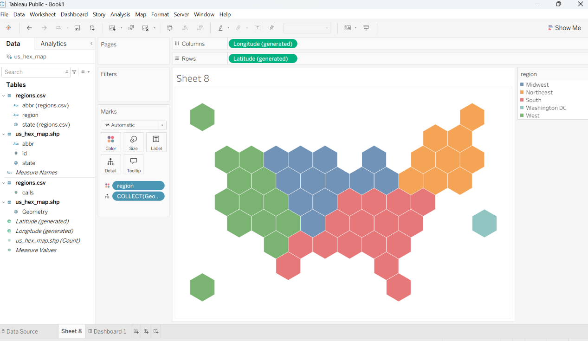
The task turned out to be more interesting than simply drawing a standard map. The idea was to show different communication channels, with each channel having its own map, and each map divided into regions. Dashboard space was tight, so the map had to be very compact.

Because every hexagon keeps its own border, there are too many lines between states that belong to the same region. This adds unnecessary visual noise.

So I decided to aim for something like this instead:

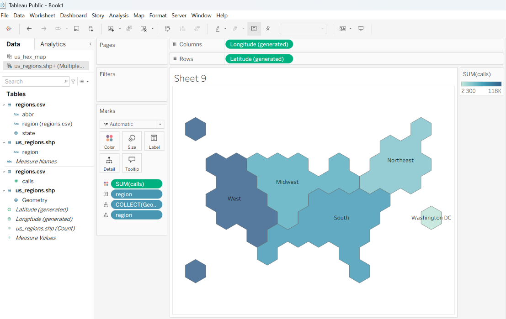 

The hexagons are merged into regions (West, Midwest, South, Northeast and Washington DC), each with its own data. On top of that, I wanted to add a **drill-down**: clicking on a region opens a map with fewer tiles and a state-level breakdown of the data.

[**Tableau Project 'Drill-down regional map with dissolved hexagons'**](https://public.tableau.com/views/us_region_map/Map2?:language=en-US&:sid=&:redirect=auth&:display_count=n&:origin=viz_share_link)

I needed **two maps**: one with hexagons (states) and one with regions (merged hexagons). However, Tableau cannot merge hexagons into custom regions without internal borders. This is where my favorite tool, **QGIS**, came to the rescue, since it can produce both maps. At this point the idea felt like a real challenge. Let's go through the process step by step, using a simplified sample dataset with number of calls by states.


There are two ways to get such result: in QGIS or in Tableau Public. But first of all we should create hex shape:

## 3. Creating the Hex Map Shapefile of US States in QGIS <a id="point-3"></a>

First, install [**QGIS**](https://qgis.org/download/). Then create a new project: in the **Project** menu, choose **New**.

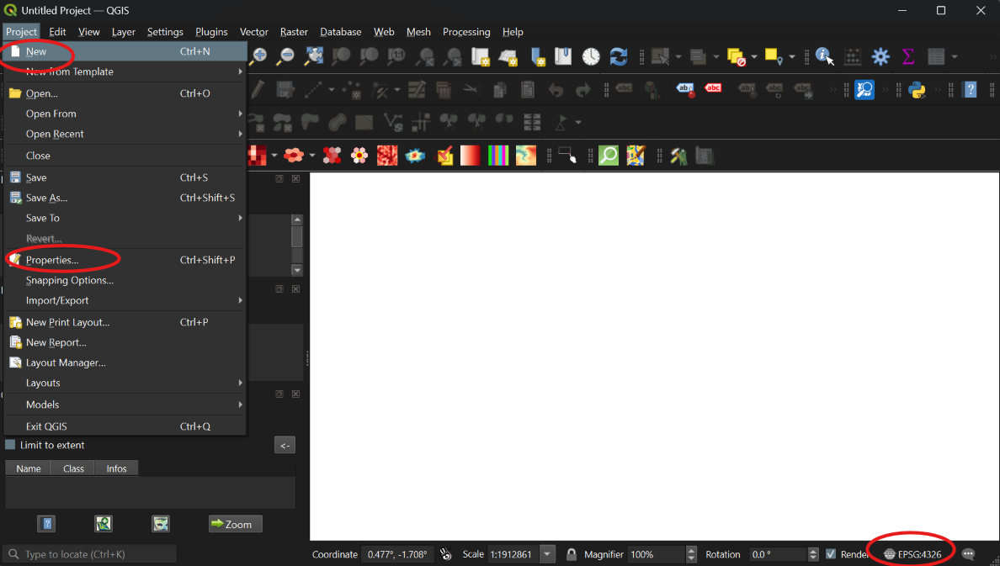 

In the bottom-right corner of the window, make sure your project uses the coordinate reference system **EPSG:4326**. 
If it doesn't, click the CRS code in the bottom-right corner, or open **Project → Properties**. In the Project Properties window, select the **CRS** tab on the left and type **EPSG:4326** into the search box.

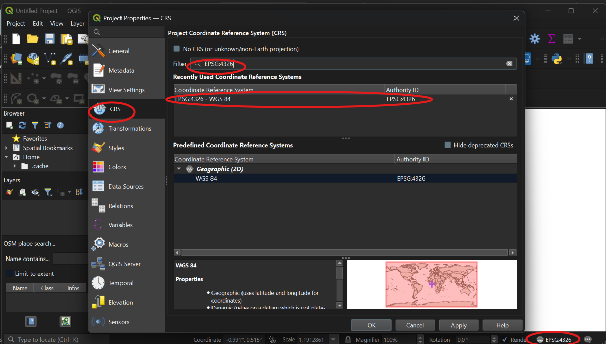 

> **Why EPSG:4326?**   EPSG:4326 (WGS 84) is the standard system of latitude and longitude, and it is a safe choice for shapefiles you want to use in Tableau.

> **Why are the tiles off the coast of Africa?** 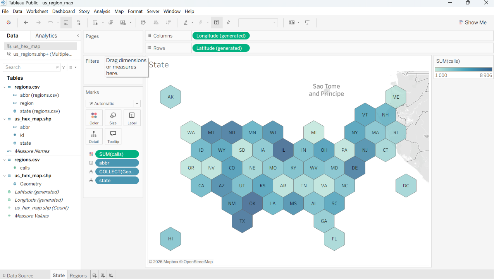

> A hex tile map is not tied to real geography: it is a schematic grid, not the actual state borders. In this tutorial the hexagons are built around the point (0, 0). Tableau reads these numbers as latitude and longitude, so it draws the tiles at 0° N, 0° E, in the Gulf of Guinea, which is where the Africa labels in the background come from. We build the grid near zero on purpose: close to the equator the Web Mercator projection used by Tableau barely distorts shapes, so the hexagons stay regular.

> Because there is no real map under the tiles, turn the background off (**Map → Background Layers**, uncheck all layers), as shown in Step 5.

 A sketch of the tile grid. Each hexagon is one state. 
 
 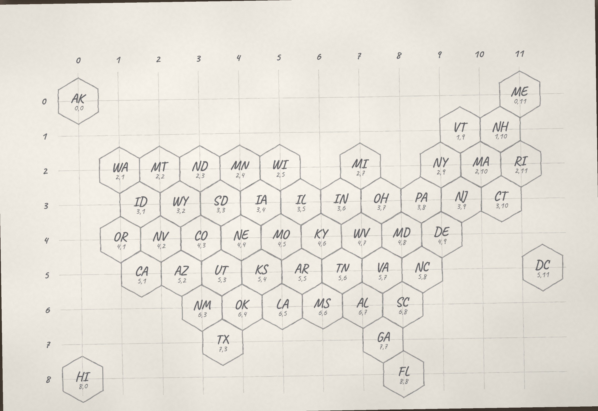

The two small numbers under the abbreviation are its **row** and **column** on the grid. The numbers along the top (0–11) are column numbers, and the numbers on the left (0–8) are row numbers.

These two numbers are exactly the last two values of each entry in the `STATES` list in the code below

> **Not familiar with Python?** You can download a ready-made `.shp` file ( [Download us_hex_map folder with shp. file](https://github.com/IaroslavaMizai/hex-map-qgis-tableau/tree/main/files/data/us_regions) ) (or use any other open hex-map shapefile) and start from **Step [4.a) Merging hexagons (no coding)](#point-4a) **.

Paste this code in Python Console in QGIS:

```
import math
from qgis.core import (QgsVectorLayer, QgsFeature, QgsGeometry, QgsPointXY,
                       QgsField, QgsProject)
from qgis.PyQt.QtCore import QVariant

# Settings

SIZE = 0.5       # hexagon radius in degrees
GAP = 1          # 1 = hexagons touch edge to edge, no gaps

# Tile grid layout: (abbreviation, state name, row, column)
# Rows are counted from the top (row 0). Odd rows are shifted half a hexagon to the right.
STATES = [
    ("AK","Alaska",0,0), ("ME","Maine",0,11),
    ("VT","Vermont",1,9), ("NH","New Hampshire",1,10),
    ("WA","Washington",2,1), ("MT","Montana",2,2), ("ND","North Dakota",2,3),
    ("MN","Minnesota",2,4), ("WI","Wisconsin",2,5), ("MI","Michigan",2,7),
    ("NY","New York",2,9), ("MA","Massachusetts",2,10), ("RI","Rhode Island",2,11),
    ("ID","Idaho",3,1), ("WY","Wyoming",3,2), ("SD","South Dakota",3,3),
    ("IA","Iowa",3,4), ("IL","Illinois",3,5), ("IN","Indiana",3,6),
    ("OH","Ohio",3,7), ("PA","Pennsylvania",3,8), ("NJ","New Jersey",3,9),
    ("CT","Connecticut",3,10),
    ("OR","Oregon",4,1), ("NV","Nevada",4,2), ("CO","Colorado",4,3),
    ("NE","Nebraska",4,4), ("MO","Missouri",4,5), ("KY","Kentucky",4,6),
    ("WV","West Virginia",4,7), ("MD","Maryland",4,8), ("DE","Delaware",4,9),
    ("CA","California",5,1), ("AZ","Arizona",5,2), ("UT","Utah",5,3),
    ("KS","Kansas",5,4), ("AR","Arkansas",5,5), ("TN","Tennessee",5,6),
    ("VA","Virginia",5,7), ("NC","North Carolina",5,8),
    ("DC","District of Columbia",5,11),
    ("NM","New Mexico",6,3), ("OK","Oklahoma",6,4), ("LA","Louisiana",6,5),
    ("MS","Mississippi",6,6), ("AL","Alabama",6,7), ("SC","South Carolina",6,8),
    ("TX","Texas",7,3), ("GA","Georgia",7,7),
    ("HI","Hawaii",8,0), ("FL","Florida",8,8),
]

# Geometry Helpers
W = math.sqrt(3) * SIZE    # width of a pointy-top hexagon
H_STEP = 1.5 * SIZE        # vertical distance between rows
R = SIZE * GAP             # drawn radius
SNAP = 1e-6                # snap vertices to a grid so neighbouring edges match exactly

def hexagon(cx, cy):
    """Build one pointy-top hexagon polygon centred at (cx, cy)."""
    pts = [QgsPointXY(cx + R*math.cos(math.radians(60*i-30)),
                      cy + R*math.sin(math.radians(60*i-30))) for i in range(6)]
    pts.append(pts[0])   # close the ring
    return QgsGeometry.fromPolygonXY([pts]).snappedToGrid(SNAP, SNAP)

# Remove layers left from previous runs so they don't overlap on the map
for old in QgsProject.instance().mapLayersByName("us_hex_map"):
    QgsProject.instance().removeMapLayer(old.id())

# Create temporary layer

layer = QgsVectorLayer("Polygon?crs=EPSG:4326", "us_hex_map", "memory")
pr = layer.dataProvider()
pr.addAttributes([QgsField("id", QVariant.Int),
                  QgsField("state", QVariant.String, len=30),
                  QgsField("abbr", QVariant.String, len=2)])
layer.updateFields()

# One Hexagon per State
feats = []
for i, (abbr, name, row, col) in enumerate(STATES, start=1):
    f = QgsFeature(layer.fields())
    # x = column * width (+ half a width on odd rows); y goes down with each row
    f.setGeometry(hexagon(col*W + (row % 2)*W/2, -row*H_STEP))
    f.setAttributes([i, name, abbr])
    feats.append(f)

# Add features to the layer
result = pr.addFeatures(feats)
layer.updateExtents()

print("Hexagons in layout:", len(STATES))
print("Hexagons created:", layer.featureCount())

# Show the Layer on the Map
QgsProject.instance().addMapLayer(layer)
iface.mapCanvas().setExtent(layer.extent())
iface.mapCanvas().refresh()

```
Open **Plugins → Python Console → Show Editor icon (the notepad with a pencil on the console toolbar), paste the code, and click the green *Run* triangle.

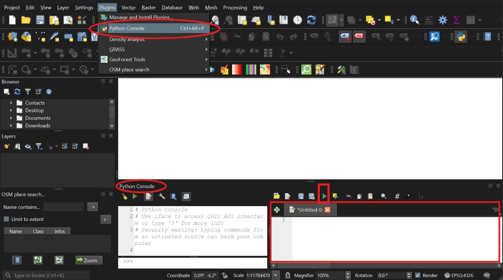 

The hexagons will appear on the map as a temporary layer.

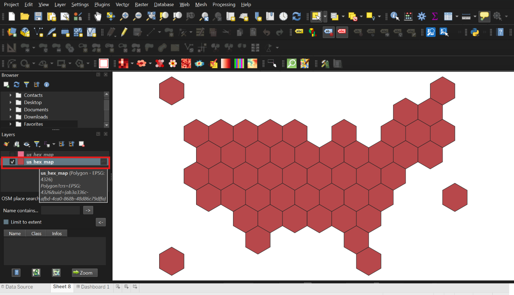 

### Save the layer as a shapefile

The layer created by the script is temporary (it lives only in memory, you will see a small chip icon next to it). To keep it:
1. Right-click the `us_hex_map` layer → **Export → Save Features As…**
2. **Format:** ESRI Shapefile
3. **File name:** click `…` and choose the folder and name, for example `us_hex_map.shp`
4. **CRS:** EPSG:4326 (WGS 84)
5. Click **OK**.

<p align="center">
  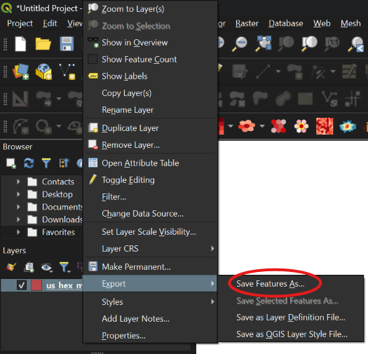
  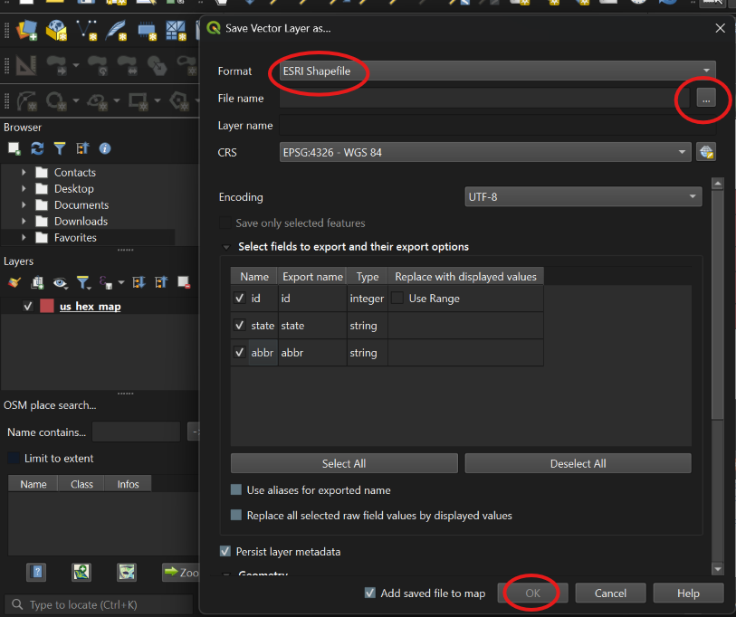
</p>

5. Click **OK**.

> **Tip: save the shapefile in its own folder with the same name `us_hex_map`.**
> A shapefile is not a single file. QGIS saves several files with the same name, so it is much easier to keep them together. In the file dialog (step 3), click **New Folder**, name it `us_hex_map`, open it, and save the file as `us_hex_map.shp` inside it.
>
> You will get this structure of your folder:
>
> ```
> us_hex_map/
> ├── us_hex_map.shp   # the shapes (geometry)
> ├── us_hex_map.shx   # index of the shapes
> ├── us_hex_map.dbf   # attribute table (state, abbr, ...)
> ├── us_hex_map.prj   # coordinate system (EPSG:4326)
> ├── us_hex_map.cpg   # text encoding (UTF-8)
> └── us_hex_map.qmd   # QGIS metadata (optional)
> ```
>
> Keep all these files together and never move or rename only the `.shp`. QGIS and Tableau need `.shp`, `.shx`, `.dbf` and `.prj` to read the map correctly. The `.cpg` file keeps special characters readable, and the `.qmd` file is optional.
> 
QGIS will add the saved shapefile to your project too. Use this file in the next steps and in Tableau.

## 4 IN QGIS <a id="point-4"></a>

## 4.1 Map with regions <a id="point-41"></a>

### 4.1.a Way 1: Merged hexagons (no coding) <a id="point-41a"></a>

> If you haven't worked with Python, or you already have a hexagonal map shapefile ( [Download us_hex_map folder with shp. file](https://github.com/IaroslavaMizai/hex-map-qgis-tableau/tree/main/files/data/us_regions) ), you can start from this step.

Composition of the regions:

- **West** (WA, OR, CA, NV, ID, MT, WY, UT, CO, AZ, NM, AK, HI)
- **Midwest (12):** ND, SD, NE, KS, MN, IA, MO, WI, IL, IN, MI, OH
- **Northeast (9):** ME, NH, VT, MA, RI, CT, NY, NJ, PA
- **South (16):** TX, OK, AR, LA, MS, AL, TN, KY, WV, VA, MD, DE, NC, SC, GA, FL
- **Washington DC:** (DC)

We will use **West** (WA, OR, CA, NV, ID, MT, WY, UT, CO, AZ, NM, AK, HI) as an example. The steps are the same for the other regions.

### Preparation

#### 1. Import `us_hex_map` into QGIS

If you downloaded the ready-made shapefile instead of running the Python script, add it to QGIS like this.

a. **Unzip the download** (if it came as a `.zip`) and keep all the files together in one folder: `us_hex_map.shp`, `.shx`, `.dbf`, `.prj` (and `.cpg` if present). QGIS needs them all, not just the `.shp`.

   b. In QGIS, go to **Layer → Add Layer → Add Vector Layer…** (or press **Ctrl+Shift+V**).
   c. Next to **Vector Dataset(s)**, click `…` and select `us_hex_map.shp`.
   d. Click **Add**, then **Close**.

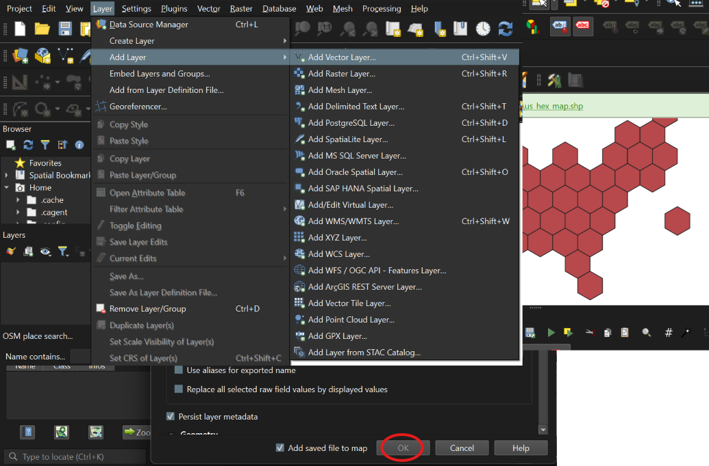
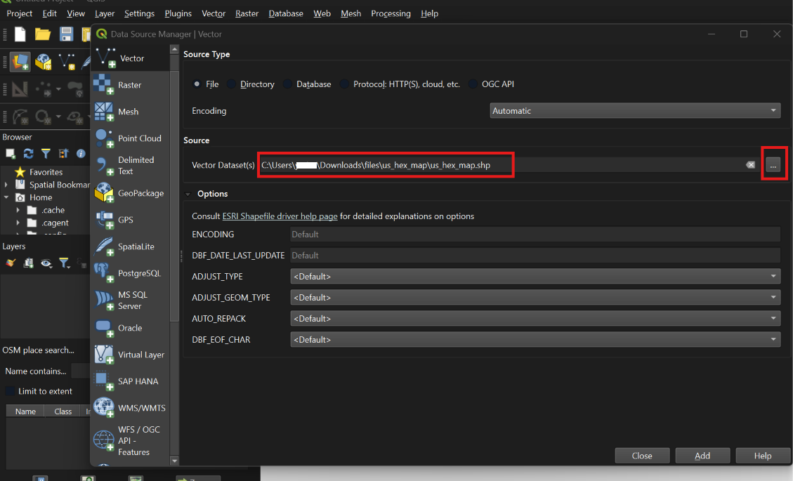 

The hexagons will appear on the map. 

**Check that it loaded correctly:**
- Right-click the layer → **Show Feature Count**. You should see **51** features (50 states + DC).
- Open the attribute table. Right-click the layer → **Open Attribute Table** It should contain the fields `id`, `state` and `abbr`.

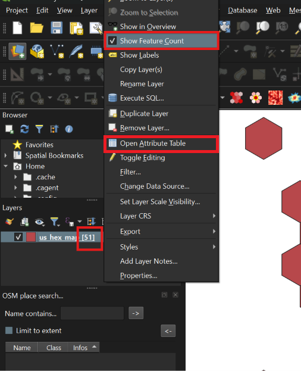
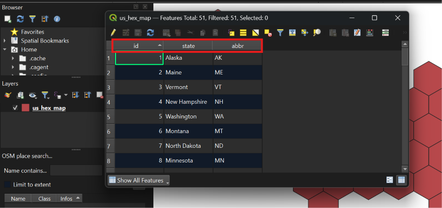

- In the bottom-right corner of QGIS, the project CRS should be **EPSG:4326**.

> **Note:** a layer added from a file is a **permanent** layer (no chip icon). If you also created the temporary layer with the Python script, uncheck or remove one of them so they don't overlap.
 


#### 2. Select the states of one region

   a. On the toolbar, choose **Select Features by Area or Single Click** (the yellow square with a cursor).
   
   b. Click the first state, then click the rest while holding **Ctrl**.

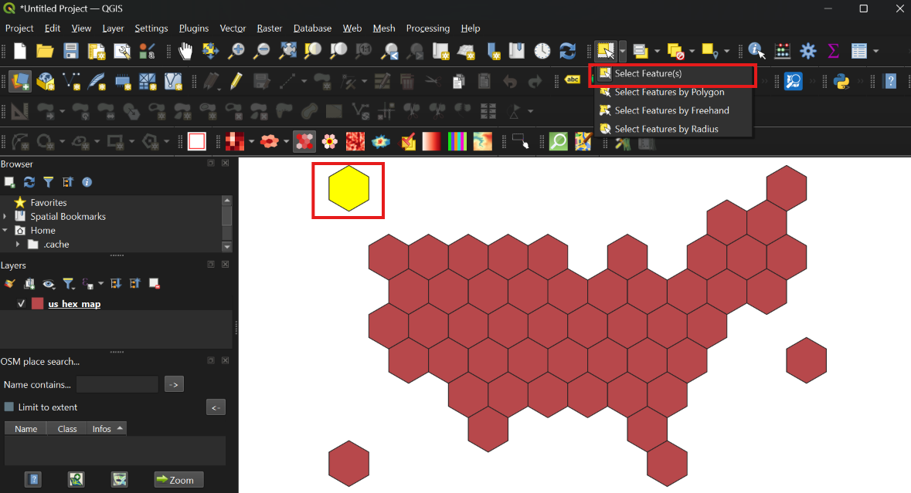 

   c. Check how many are selected at the bottom of the QGIS window (or **Layer → Show Selected Features Count**). For West there should be 11.
   
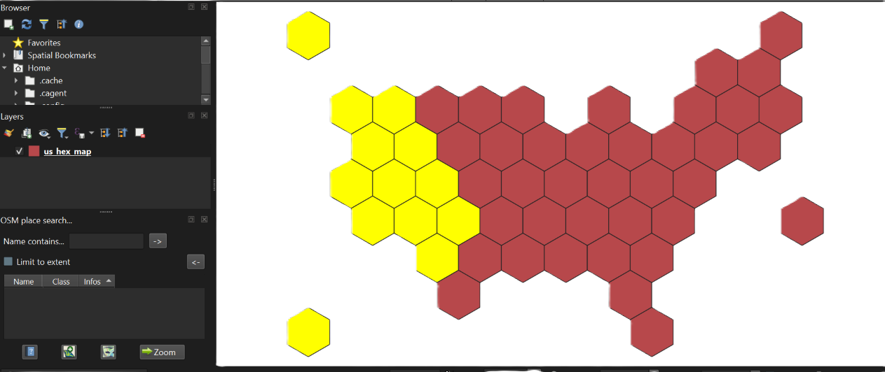 

#### 3. Dissolve the selection

   a. Open the **Processing Toolbox** (Ctrl+Alt+T) and find **Dissolve**.

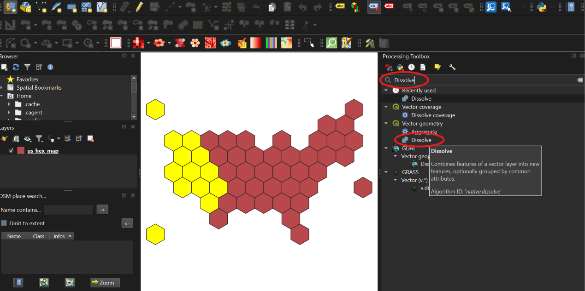 

   b. Set it up:
   - **Input layer:** `us_hex_map`
   - Turn on **Selected features only**
   - **Dissolve field(s):** leave empty
   - **Dissolved:** save to a  temporary file **West**

c. Click **Run** then close Dissolve window.

You will get a new layer with a single West shape.

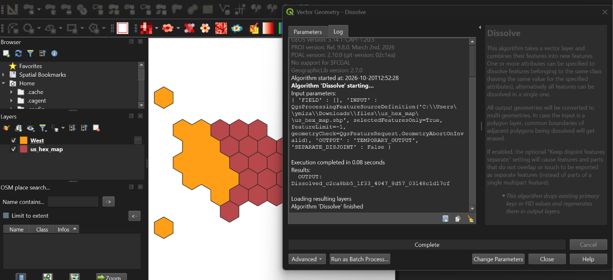 

#### 4. Add the region name

   a. Select the new layer and open the attribute table.

   b. Turn on editing (the pencil) and add a field with the **Field Calculator** (Ctrl+I):

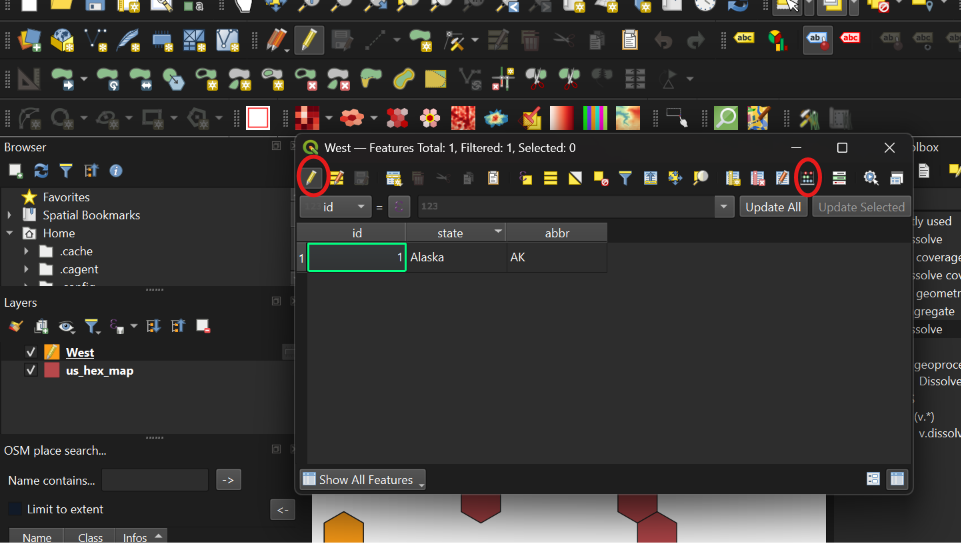

   - **Output field name:** `region`
   - **Output field type:** Text (string), length 10 
   - **Expression:** `'West'`

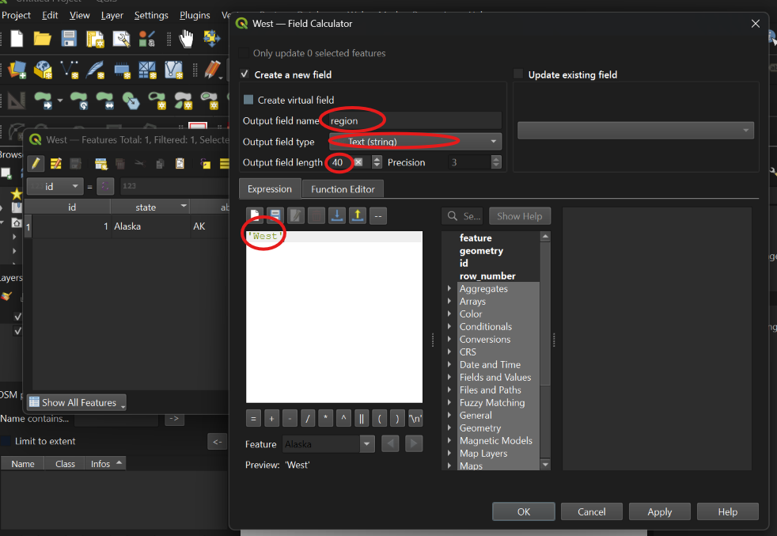
     
c. Save the edits and turn editing off (the pencil again). 

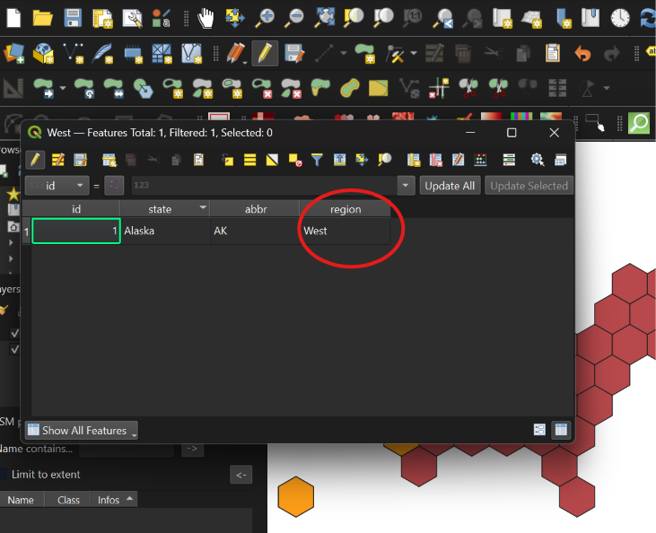

#### 5. Repeat for the other regions

Repeat Steps 1–4 for Midwest, Northeast and South. Do Washington DC separately in the same way, but set length 15.
All regions are ready.

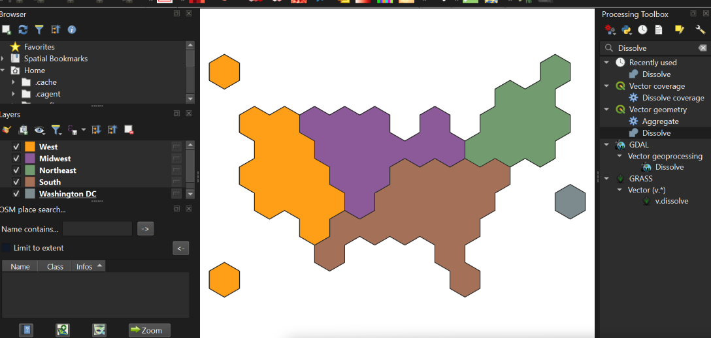 

#### 6. Merge the layers into one

   a. **Processing Toolbox → Merge vector layers.**

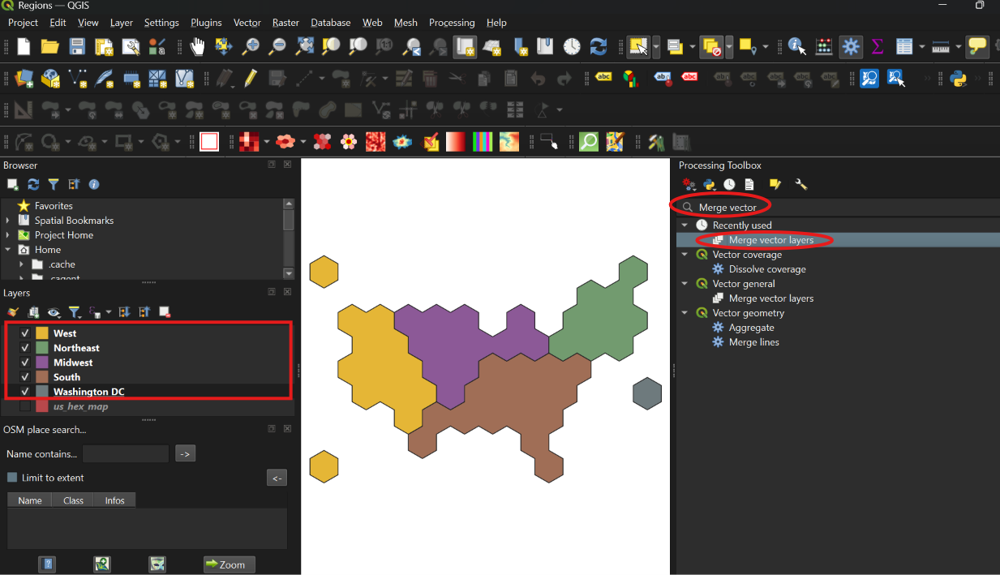 

   b. **Input layers:** select all region layers (West, Midwest, Northeast, South, Washington DC).
   
   c. Click **Run**.
   
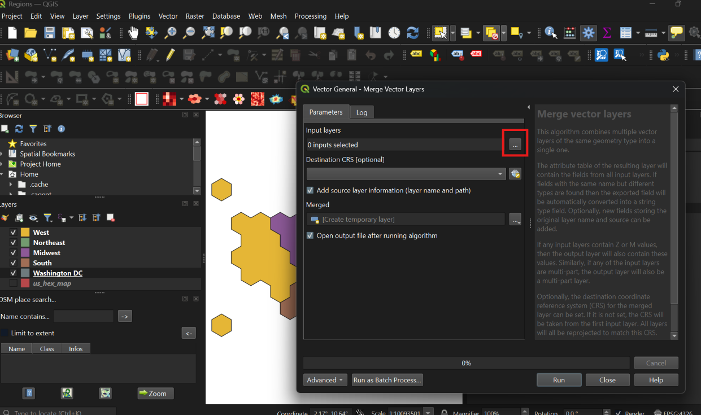 

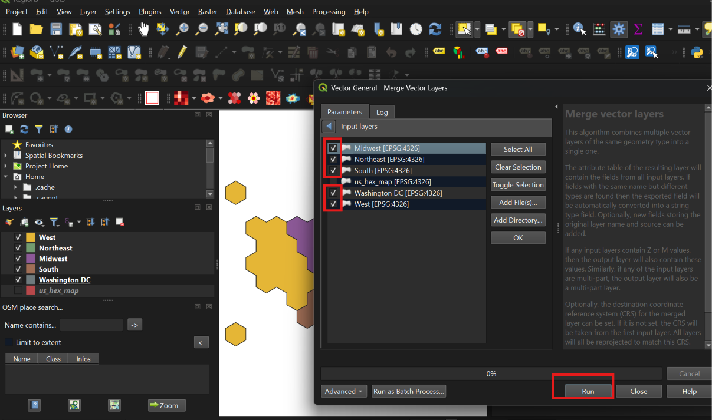 

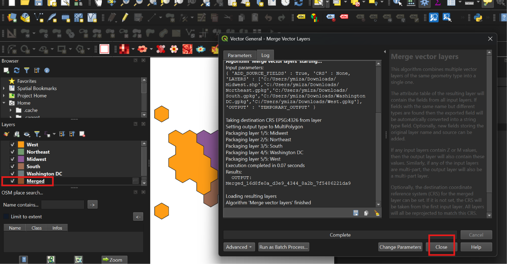 

#### 7. Clean up and export

Right-click the layer →  **Export → Save Features As…** → ESRI Shapefile → CRS EPSG:4326 → Keep only the `region` field → **OK**.
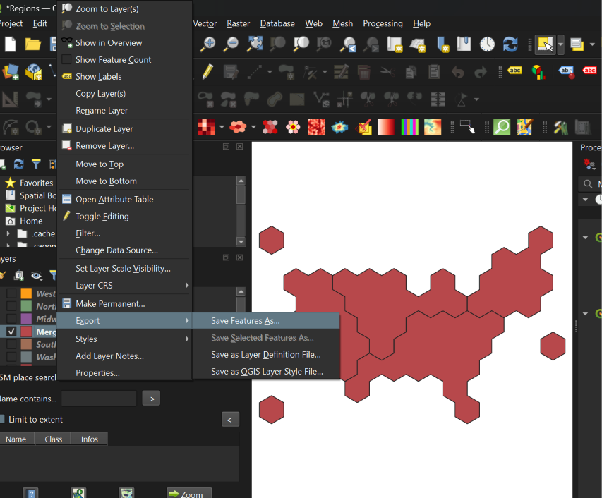 

### 4.1.b) Way: Generate the shapefile with Python <a id="point-4b"></a>

This script reads two files from your computer, so before running it make sure you have:

   1. **`us_hex_map.shp`** (with its `.shx`, `.dbf` and `.prj` files). You either saved it in Section 3 (**Export → Save Features As…**) or downloaded the ready-made version and save in folder `us_hex_map` ( [Download us_hex_map folder with shp. file](https://github.com/IaroslavaMizai/hex-map-qgis-tableau/tree/main/files/data/us_hex_map) ).
   2. **`regions.csv`**, the table that maps each state to its region ( [Download regions.csv  file](https://github.com/IaroslavaMizai/hex-map-qgis-tableau/blob/main/files/data/regions.csv) ).

Keep both files in one folder, for example the `data`.

> Before running the Python script below, make sure to update SRC_PATH and CSV_PATH with the actual file paths where these files are saved on your computer (e.g., replace "C:/path/data/..." with your custom folder path). Otherwise, the script will fail with an error.


```
import csv
from qgis.core import (QgsVectorLayer, QgsFeature, QgsGeometry, QgsField,
                       QgsProject)
from qgis.PyQt.QtCore import QVariant

# Settings

SRC_PATH   = "C:/path/data/us_hex_map/us_hex_map.shp"   # the hexagon shapefile (1 hexagon per state)
CSV_PATH   = "C:/path/data/regions.csv"      # table: state abbreviation -> region
KEY_FIELD  = "abbr"      # field in the shapefile used to match states with the CSV
CSV_KEY    = "abbr"      # CSV column with the state abbreviation
CSV_REGION = "region"    # CSV column with the region name
SNAP       = 1e-6        # snap vertices to a grid so neighbouring hexagons share edges exactly

def drop_holes(geom):
    """Keep only the outer boundary of each polygon (removes tiny holes that can appear after merging)."""
    polys = []
    for part in geom.asGeometryCollection():
        rings = part.asPolygon()
        if rings:
            polys.append(QgsGeometry.fromPolygonXY([rings[0]]))   # rings[0] = outer ring, other rings = holes
    return QgsGeometry.collectGeometry(polys) if polys else geom

# Read the csv file 
mapping = {}
with open(CSV_PATH, encoding="utf-8-sig", newline="") as fh:
    sample = fh.read(4096)
    fh.seek(0)
    dialect = csv.Sniffer().sniff(sample, delimiters=",;\t")   # detects the separator
    reader = csv.DictReader(fh, dialect=dialect)
    reader.fieldnames = [n.strip() for n in reader.fieldnames]
    for row in reader:
        k = (row[CSV_KEY] or "").strip().upper()
        v = (row[CSV_REGION] or "").strip()
        if k and v:
            mapping[k] = v
print("Rows in CSV:", len(mapping))   # should print 51

# Open the hexagon shape file and group the hexagons by region 

src = QgsVectorLayer(SRC_PATH, "src", "ogr")
if not src.isValid():
    raise Exception("Could not open " + SRC_PATH)   # check the path

groups, missing = {}, []
for f in src.getFeatures():
    key = str(f[KEY_FIELD]).strip().upper()
    region = mapping.get(key)
    if region is None:
        missing.append(key)   # state not found in the CSV
        continue
    groups.setdefault(region, []).append(f.geometry().snappedToGrid(SNAP, SNAP))
if missing:
    print("WARNING, these states are not in the CSV (skipped):", missing)

# Merge the hexagons of each region  

out = QgsVectorLayer("MultiPolygon?crs=EPSG:4326", "us_regions", "memory")   # temporary layer for the result
pr = out.dataProvider()
pr.addAttributes([QgsField("region", QVariant.String, len=40),
                  QgsField("n_states", QVariant.Int)])   # n_states = number of states in the region
out.updateFields()

feats = []
for region, geoms in groups.items():
    merged = drop_holes(QgsGeometry.unaryUnion(geoms))   # union = dissolve the hexagons into one shape
    f = QgsFeature(out.fields())
    f.setGeometry(merged)
    f.setAttributes([region, len(geoms)])
    feats.append(f)
    print(" ", region, "->", len(geoms), "states")
pr.addFeatures(feats)
out.updateExtents()

# Show the temporart layer

# Remove a previous "us_regions" layer first, so the layers don't overlap
for old in QgsProject.instance().mapLayersByName("us_regions"):
    QgsProject.instance().removeMapLayer(old.id())

QgsProject.instance().addMapLayer(out)
iface.mapCanvas().setExtent(out.extent())
iface.mapCanvas().refresh()
```
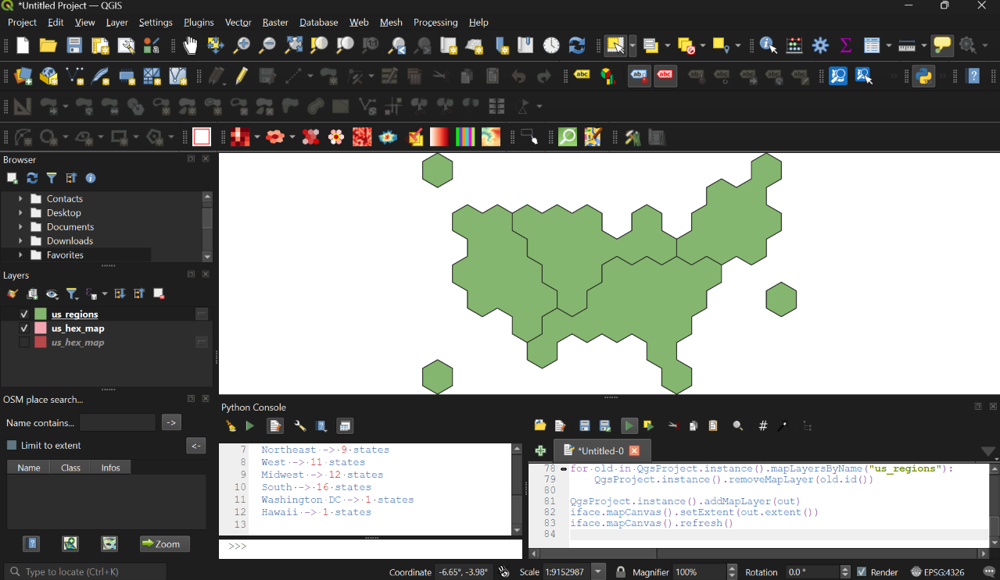 

Open **Plugins → Python Console → Show Editor icon (the notepad with a pencil on the console toolbar), paste the code, and click the green *Run* triangle.

### Save the regions layer as a shapefile

The `us_regions` layer created by the script is temporary: it lives only in memory (you will see a small chip icon next to it). To keep it and use it in Tableau:
   1. Right-click the `us_regions` layer → **Export → Save Features As…**
   2. **Format:** ESRI Shapefile
   3. **File name:** click `…` and choose the folder and name, for example `us_regions.shp`
   4. **CRS:** EPSG:4326 (WGS 84)
   5. Click **OK**.
   
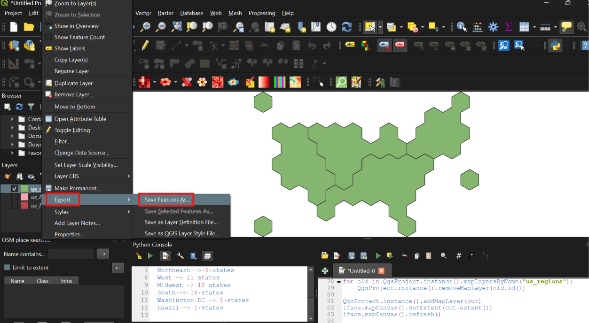 
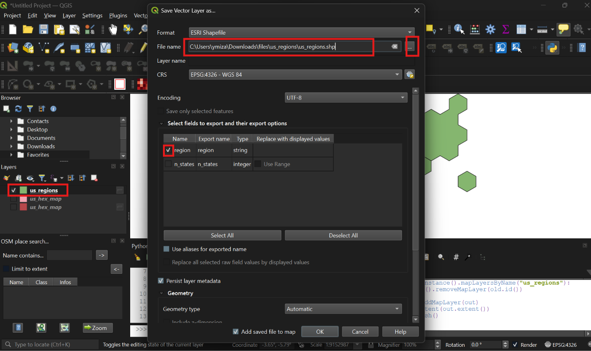 

> **Note:** temporary layers are lost if you close QGIS Project without saving. Export the layer before closing project.

### 4.2. Import the map into Tableau <a id="point-42"></a>

> Before you start, make sure that all the shapefiles you created earlier (`.shp`) and their supporting files (`.shx`, `.dbf`, `.prj`) are stored together in one folder.

#### States map

   1. Create a new project in Tableau Public and import `us_hex_map.shp`.
   2. Join it with `regions.csv` on the common column `state`. Join type: **Left Join**.

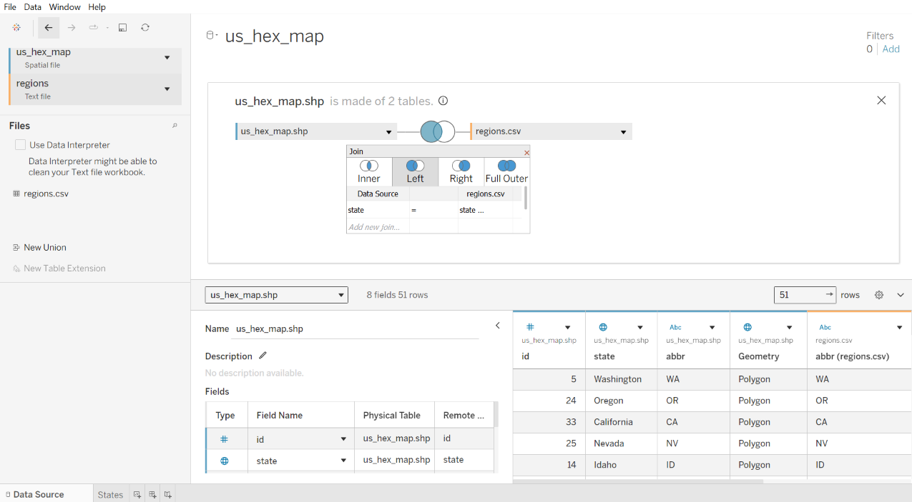

   3. On the **Marks** card, drag **Geometry** and `state` to **Detail**, `calls` to **Color**, and `abbr` to **Label**.
   4. Rename the sheet to **States**.


#### Regions map

   1. Import `us_regions.shp` in the same way.
   2. Link the two data sources on the common field `region` (**Use as linking fields**).
   3. On the **Marks** card, drag **Geometry** and `region` to **Detail**, `calls` to **Color**, and `region` to **Label**.
   4. Rename the sheet to **Regions**.

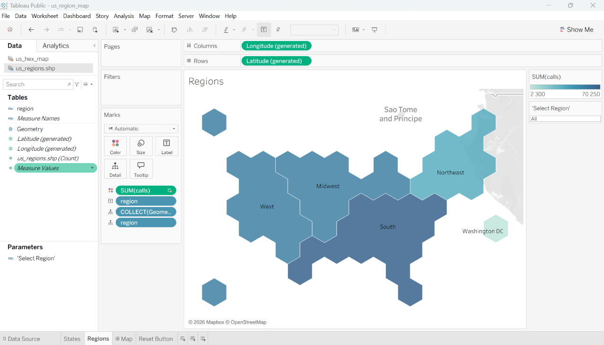

#### Remove the background

1. On both sheets, open the **Format** menu and set the **Worksheet** shading to **None**.

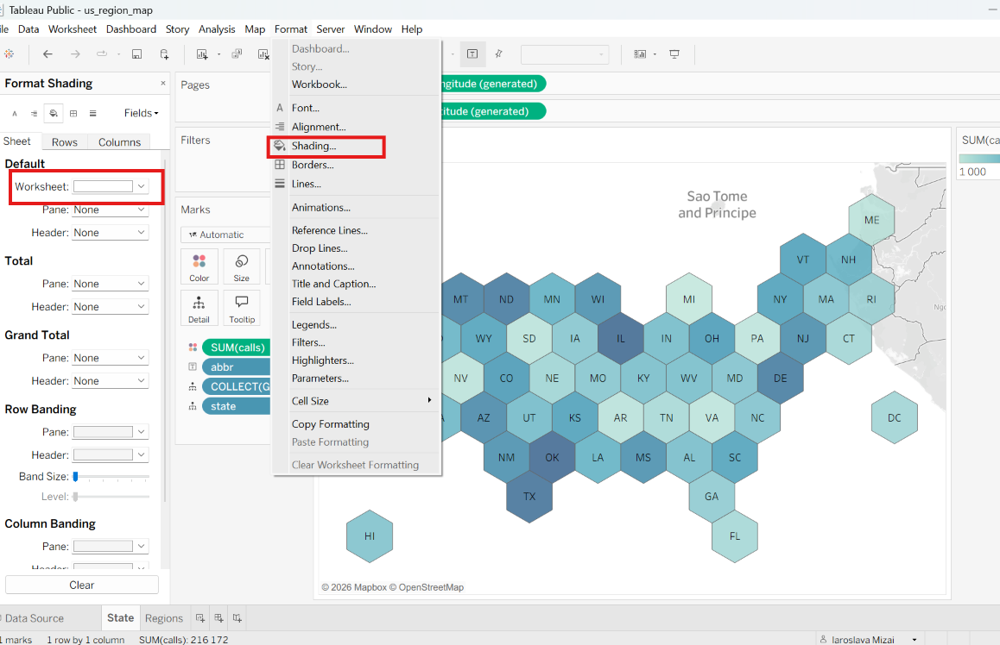

   2. Go to **Map → Background Layers** and uncheck all points in the **Background Map Layers**.
   3. Remove the titles on both sheets.

### 4.3. Drill-down effect for the map <a id="point-43"></a>

#### Parameter and filters

1. Create a parameter called **Select Region** with the default value **South**.

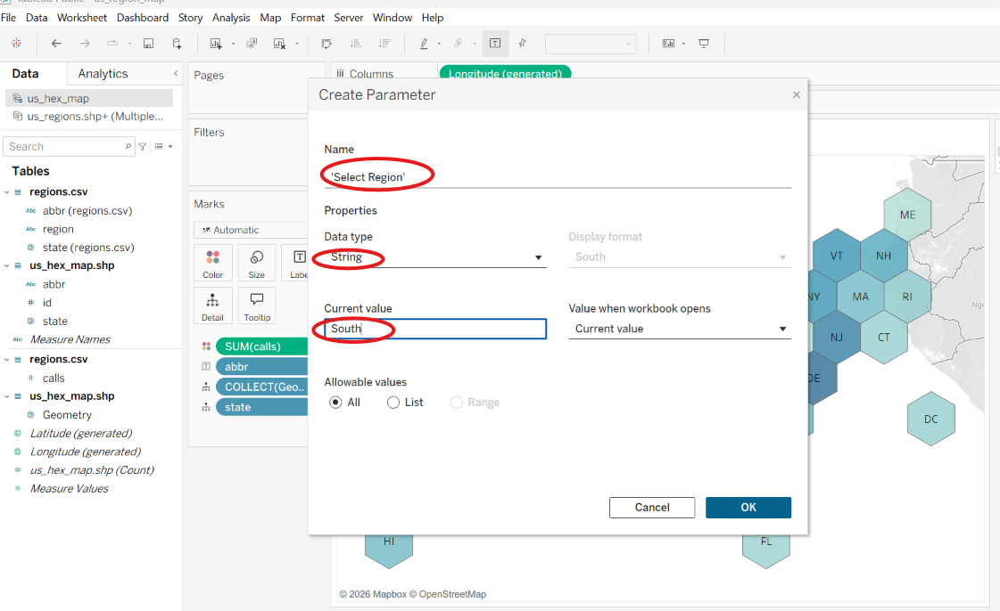

2. Create a calculated field **Parameter Filter for States Map** with the formula `[region]=[Select Region]` and add it to the filters on the **States** sheet.

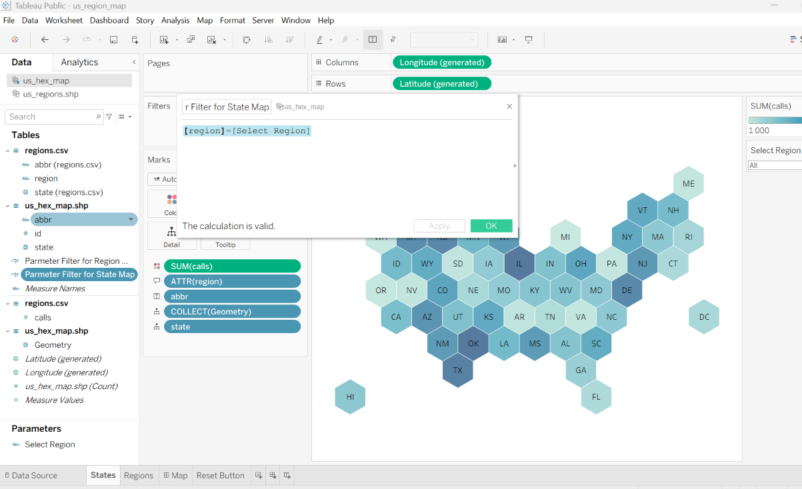

3. Drag the field to **Filters**. In the filter window, choose **Custom value list**, type `True`, click the plus (cross) icon on the right, and save.

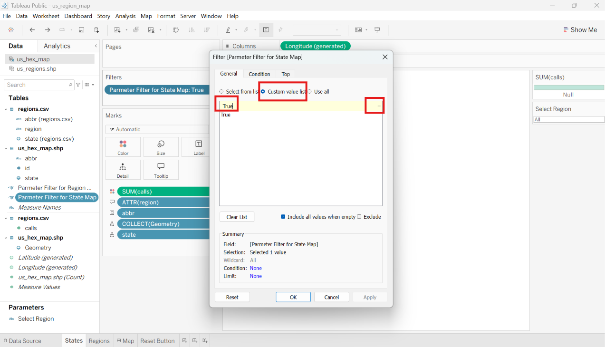

The map will disappear. This is expected, because the default value of **Select Region** is South.

4. On Sheet 'States' create a calculated field **Parameter Filter for Region Map** with the formula `[Select Region]="All"` and add it to the filters on the **Regions** sheet in the same way, selecting `True`. As a result you will see the South region map (because South is the default parameter value).

#### Dashboard

1. Create a dashboard called **Map**. Place both sheets (**States** and **Regions**) in a vertical container. Only the **Regions** map will be visible, because the **States** sheet is empty for now.
2. Remove all the legends and filters that Tableau added automatically when you dragged the sheets into the container.
3. Add a text object with the text `Drill-Down Regional Map` to the container.

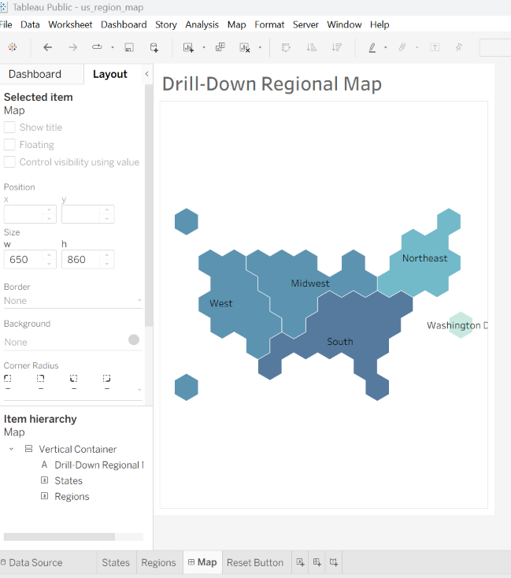

#### The drill-down action

1. In the **Dashboard** menu, choose **Actions → Add Action → Change Parameter**.
2. Name the action **Drill-Down Maps**.
3. **Source Sheets:** **States** and **Regions**.
4. **Target Parameter:** **Select Region**.
5. **Source field:** `region`.
6. **Run action on:** **Select**.
7. **Clearing the selection will:** **Set value to**, leave the value empty.

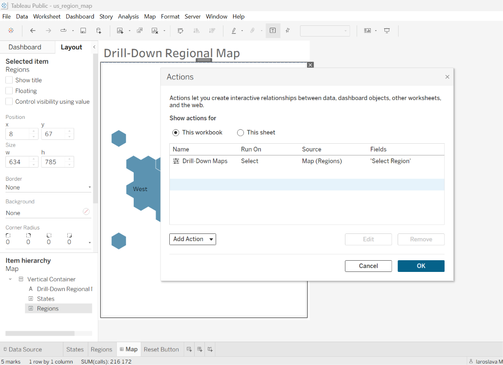
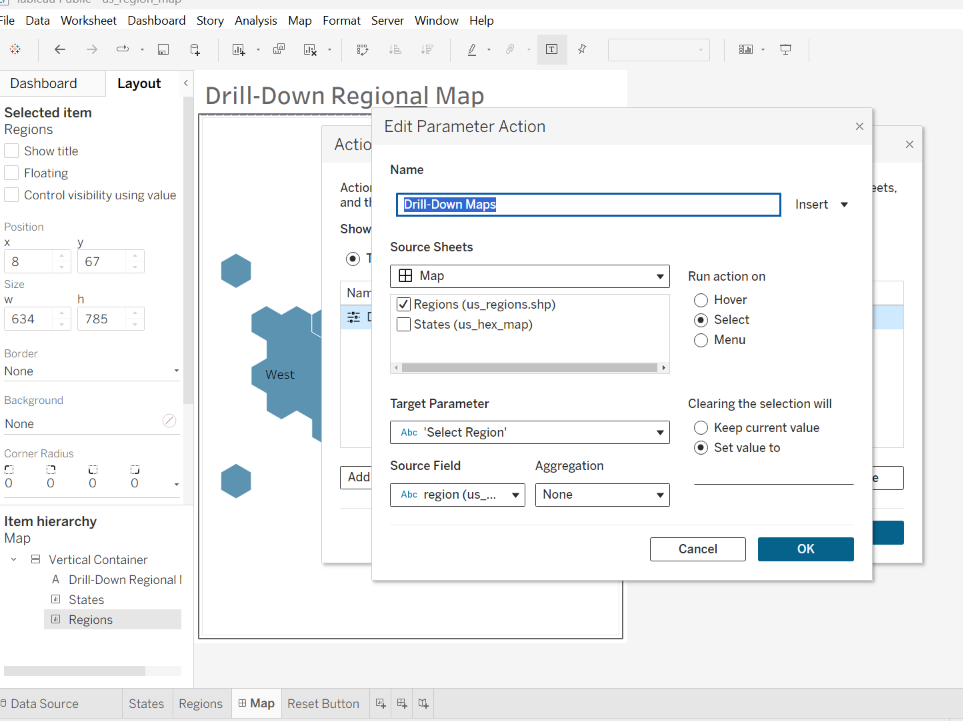

#### The Reset button

The button clears the selection and brings back the map with all regions.

1. Create a sheet called **Reset Button**. On the **Marks** card, choose **Text**, add a field with the text `Reset Button` as the text, and put the field `All` on **Detail**.

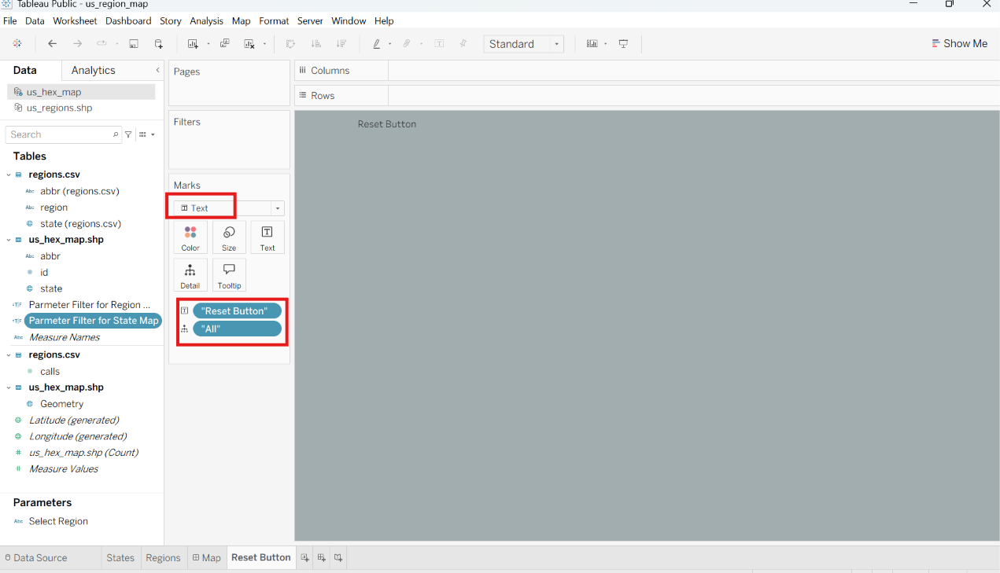

2. In the **Dashboard** menu, choose **Actions → Add Action → Change Parameter**.
3. Name the action **Reset Maps**.
4. **Source Sheet:** **Reset Button**.
5. **Target Parameter:** **Select Region**.
6. **Source field:** `All`.
7. **Run action on:** **Select**.
8. **Clearing the selection will:** **Set value to**, and enter `All`.

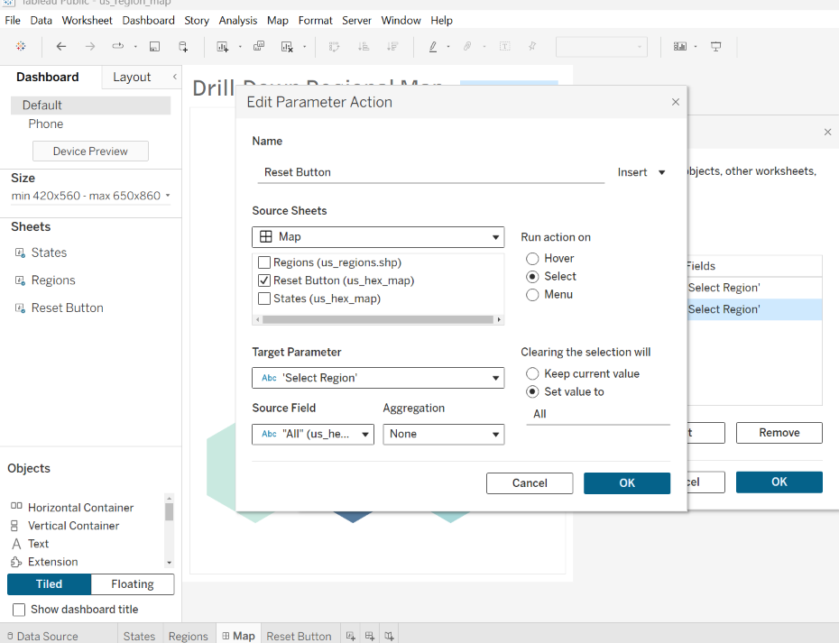

9. Add the **Reset Button** sheet to the dashboard and adjust its size on the **Layout** panel.

You can download the finished project here: [**Drill-down regional map with dissolved hexagons**](https://public.tableau.com/views/us_region_map/Map2?:language=en-US&:sid=&:redirect=auth&:display_count=n&:origin=viz_share_link)

## 5 In Part 1 we dissolved the state hexagons into regions (West, Midwest, South, Northeast) in QGIS. Now we’ll do the same thing directly in Tableau Public, without touching the shapefile again. The trick is the Group feature, which makes Tableau Public merge geometries on the fly.

## 6. Files used in this project <a id="point-6"></a>

```
hex-map-qgis-tableau/
├── README.md
├── LICENSE
└── files/
    ├── data/
    │   ├── us_hex_map/          # hexagon shapefile, one hexagon per state
    │   ├── us_regions/          # shapefile with merged regions
    │   └── regions.csv          # state → region table
    ├── images/                  # screenshots for this tutorial
    └── us_region_map.twbx       # Tableau packaged workbook
```

| File | What it is | Used in |
|---|---|---|
| [us_hex_map](files/data/us_hex_map/) | Hex map of US states (51 hexagons). Keep `.shp`, `.shx`, `.dbf`, `.prj` and `.cpg` together. | [Section 3](#point-3), [4.a](#point-4a), [4.b](#point-4b) |
| [us_regions](files/data/us_regions/) | Regions made from merged hexagons (West, Midwest, Northeast, South, Washington DC). | [Section 4](#point-4), [5](#point-5) |
| [regions.csv](files/data/regions.csv) | Table that maps each state to its region. | [4.b](#point-4b), [5](#point-5) |
| [us_region_map.twbx](files/us_region_map.twbx) | Finished Tableau workbook with the drill-down dashboard. | [Section 6](#point-6) |

**Useful links**

- [Call Center Dashboard on Tableau Public](https://public.tableau.com/views/CallCenterDashboard_17482539625320/CHANNEL)
- [Tableau Public](https://public.tableau.com/) (free)
-----------------------------------------------------------------------------

## 7. Author and License <a id="point-7"></a>

**Author:** Iaroslava Mizai

**Tutorial and documentation:** Licensed under [CC BY 4.0](https://creativecommons.org/licenses/by/4.0/).

**Source code:** Licensed under the [MIT License](LICENSE).

You are welcome to reuse, adapt, and share this tutorial and code. When referencing or adapting the tutorial, please credit the original author and link to this repository.

If you make changes, please indicate that the material has been modified.

**Author links:**
- GitHub: https://github.com/iaroslavamizai
- Tableau Public: https://public.tableau.com/app/profile/iaroslava/vizzes
